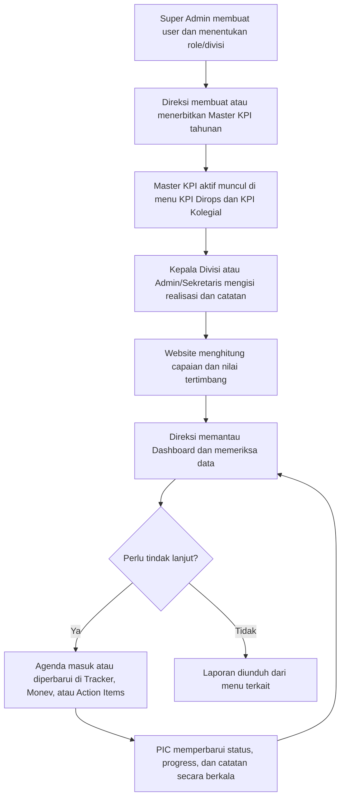
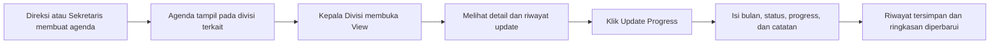

# Alur Penggunaan Website KPI Direktorat Operasional

## 1. Tujuan dan Posisi Excel

File `trackerKPI.xlsx` digunakan sebagai referensi struktur data, sumber awal, dan acuan proses. Pengisian operasional selanjutnya dilakukan melalui website agar akses, riwayat perubahan, dan monitoring dapat dibedakan berdasarkan role.

Dashboard tidak menjadi tempat input. Nilainya merupakan ringkasan otomatis dari KPI Dirops, KPI Kolegial, Tracker Divisi, Monev Danareksa, dan Action Items.

## 2. Alur Utama

## 3. Pembagian Role

| Role | Tanggung Jawab | Menu yang Digunakan | Tidak Dilakukan |
|---|---|---|---|
| Super Admin | Mengelola akun, role, divisi akses, dan bantuan administrasi data | Semua menu, terutama Master User & Role | Tidak menjadi pemilik validasi bisnis KPI |
| Direksi | Menetapkan Master KPI, memantau seluruh capaian, mengelola agenda strategis, dan mengambil keputusan | Dashboard, KPI Dirops, KPI Kolegial, Tracker Divisi, Monev, Action Items, Master KPI | Tidak perlu mengisi progres rutin milik setiap divisi |
| Kepala Divisi | Mengisi realisasi KPI yang menjadi tanggung jawab divisinya dan memperbarui Tracker Divisi | Dashboard, KPI Dirops, KPI Kolegial, Tracker Divisi | Tidak membuat Master KPI atau mengubah agenda divisi lain |
| Admin/Sekretaris | Membantu input realisasi berdasarkan data resmi, mengelola agenda lintas fungsi, dan menyiapkan laporan | Dashboard, KPI Dirops, KPI Kolegial, Tracker Divisi, Monev, Action Items | Tidak mengubah struktur Master KPI |

Menu yang tidak menjadi kewenangan role tidak ditampilkan di sidebar.

## 4. Proses Awal Tahun - Master KPI

**Pelaksana:** Direksi. Super Admin hanya membantu secara administratif bila diperlukan.

1. Buka **Master KPI** lalu pilih **Buat Master KPI**.
2. Pilih jenis KPI: **Dirops** atau **Kolegial**.
3. Isi metadata tahun, tanggal dibuat, tanggal terbit, pembuat, dan status master.
4. Masukkan indikator berdasarkan kontrak manajemen resmi: kode, kategori/kelompok, penanggung jawab, satuan, bobot, polaritas, target tahunan, dan target TW1-TW4.
5. Pastikan total bobot sesuai kontrak dan penanggung jawab setiap indikator sudah benar.
6. Ubah status menjadi **Active** setelah disahkan. Hanya master aktif yang dipakai sebagai dasar pengisian kinerja.

Catatan referensi 2026: bobot KPI Direktorat pada kontrak resmi adalah 15% / 15% / 10% / 20%, sedangkan materi paparan Juni mencantumkan 15% rata. Angka final perlu dikonfirmasi kepada Corp Sec/SDM sebelum master diterbitkan.

## 5. Pengisian KPI Dirops dan KPI Kolegial

**Pelaksana utama:** Kepala Divisi sesuai indikator. **Pendamping:** Admin/Sekretaris. **Reviewer:** Direksi.

1. Kepala Divisi masuk menggunakan akun dan divisinya.
2. Buka **KPI Dirops** atau **KPI Kolegial**.
3. Sistem hanya menampilkan indikator milik divisi tersebut dan indikator lintas divisi.
4. Isi **Realisasi TW1-TW4** sesuai periode berjalan serta **Catatan / Update** sebagai penjelasan dan bukti ringkas.
5. Sistem menghitung **Capaian %** dan **Nilai Tertimbang** secara otomatis.
6. Admin/Sekretaris mengecek kelengkapan data, lalu Direksi meninjau hasil melalui Dashboard dan detail KPI.

Struktur indikator, target, satuan, bobot, dan polaritas berasal dari Master KPI sehingga tidak dibuat ulang pada menu kinerja.

## 6. Tracker Divisi

**Pemilik agenda:** Direksi/Admin-Sekretaris. **Pengisi progres:** Kepala Divisi terkait.

Data dasar agenda terdiri dari Divisi, PIC, Pekerjaan/Follow-Up, Output/Target, dan Deadline. Data ini dibuat dari arahan resmi, rapat koordinasi, atau tindak lanjut Direksi. Kepala Divisi memperbarui **Bulan Progress, Status, Progress (%), dan Catatan Terakhir** setiap bulan tanpa mengubah definisi agenda.

Status yang digunakan: **Belum Mulai**, **On Progress/On Track**, **Terkendala/At Risk**, dan **Selesai**. Setiap update harus masuk ke riwayat, bukan menimpa jejak update sebelumnya.

## 7. Monev Danareksa

**Pemilik:** Direksi. **Pengelola:** Admin/Sekretaris. **Sumber update:** PIC terkait.

1. Agenda dibuat berdasarkan arahan Monev Danareksa atau isu strategis yang telah ditetapkan.
2. Admin/Sekretaris mencatat prioritas, PIC, target waktu, status awal, dan rencana solusi.
3. PIC menyampaikan perkembangan; Admin/Sekretaris atau Direksi memperbarui status, progress, dan catatan setiap bulan.
4. Pembaruan dilakukan melalui **View -> Update Progress** agar identitas agenda tidak ikut berubah.
5. Setiap pembaruan masuk ke tabel riwayat berisi tanggal, bulan, status, progress, dan catatan.
6. Item **At Risk** atau **Terkendala** otomatis menjadi perhatian Direksi pada Dashboard.
7. Direksi menentukan eskalasi, koreksi target, atau tindak lanjut baru.

## 8. Action Items BOD-BOC

**Pemilik:** Direksi. **Pengelola:** Admin/Sekretaris. **Pelaksana:** PIC Divisi.

1. Setelah rapat, Admin/Sekretaris membuat Action Item dari MoM.
2. Isi Agenda, Tindak Lanjut, Target Waktu, PIC, dan PIC Divisi.
3. PIC Divisi menjalankan tindak lanjut dan menyampaikan progres.
4. Admin/Sekretaris membuka **View**, memeriksa detail dan riwayat, lalu memilih **Update Progress**.
5. Update bulanan hanya mengubah bulan, status, progress, dan catatan/rencana solusi.
6. Direksi mengevaluasi item terlambat, progres rendah, atau terkendala dari riwayatnya.
7. Action Item ditutup saat output telah diterima dan status menjadi **Selesai**.

## 9. Siklus Operasional

| Waktu | Pelaksana | Aktivitas |
|---|---|---|
| Awal tahun / saat kontrak terbit | Direksi | Membuat dan mengaktifkan Master KPI |
| Setiap bulan | Kepala Divisi | Update Tracker Divisi |
| Setiap bulan | PIC dan Admin/Sekretaris | Update Monev dan Action Items |
| Setiap triwulan | Kepala Divisi / Admin-Sekretaris | Isi realisasi KPI dan catatan triwulan |
| Setelah periode input | Direksi | Review Dashboard, capaian, risiko, dan tindak lanjut |
| Saat rapat/pelaporan | Direksi / Admin-Sekretaris | Download laporan dari masing-masing menu |

## 10. Pemetaan Excel ke Website

| Sheet Excel | Menu Website | Sumber Data | Pengisi Berkala |
|---|---|---|---|
| Dashboard | Dashboard | Otomatis dari seluruh modul | Tidak ada input manual |
| KPI Dirops | KPI Dirops | Master KPI Dirops | Kadiv terkait / Admin-Sekretaris, triwulanan |
| KPI Kolegial | KPI Kolegial | Master KPI Kolegial | Kadiv terkait / Admin-Sekretaris, triwulanan |
| Tracker Divisi | Tracker Divisi | Arahan Direksi/Rakornas/rapat koordinasi | Kepala Divisi, bulanan |
| Monev Danareksa | Monev Danareksa | Arahan Monev dan isu strategis resmi | Direksi/Admin-Sekretaris berdasarkan update PIC |
| Action Items BOD-BOC | Action Items | MoM rapat BOD-BOC | Admin-Sekretaris berdasarkan update PIC Divisi |

## 11. Aturan Kontrol Data

- Data master dan agenda dasar hanya berubah bila ada revisi resmi.
- Kepala Divisi hanya melihat dan mengisi data divisinya serta agenda lintas divisi.
- Realisasi KPI diisi per triwulan; Tracker, Monev, dan Action Items diperbarui minimal setiap bulan.
- Progress menggunakan rentang 0-100% dan harus konsisten dengan status.
- Status Selesai harus disertai catatan hasil/output akhir.
- Semua perubahan menyimpan pengguna, waktu perubahan, dan riwayat update.
- Laporan diunduh dari menu sumber agar konteks dan filter tahun tetap benar.
